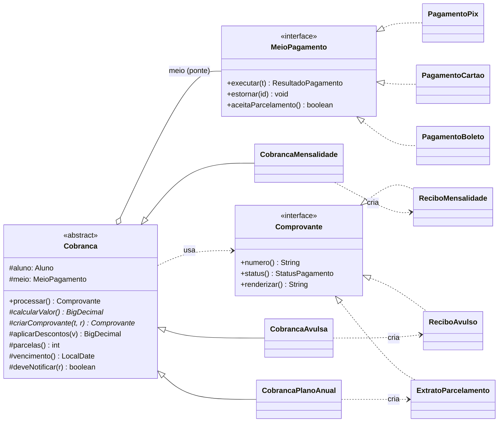
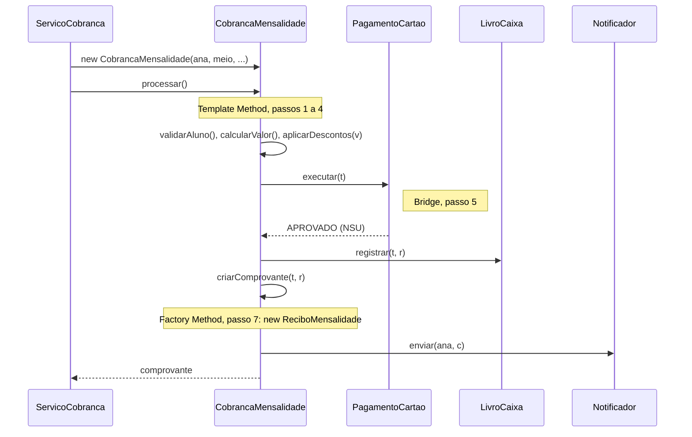

# FitPay

Sistema de cobrança de uma rede de academias, em Java, que aplica três padrões de projeto GoF:

| Padrão | Família | O que resolve no FitPay |
| --- | --- | --- |
| **Bridge** | Estrutural | Separa *o que se cobra* (mensalidade, avulsa, plano anual) de *como se cobra* (Pix, cartão, boleto) |
| **Template Method** | Comportamental | Fixa a ordem dos 8 passos de toda cobrança em `Cobranca.processar()` |
| **Factory Method** | Criação | Deixa cada tipo de cobrança criar o seu comprovante |

Projeto da Atividade Avaliativa 4 de Arquitetura de Software (Kit G), Universidade Presbiteriana Mackenzie, 6ª etapa, turma A. Prof. Adriano Pereira Almeida.

**Grupo:** Henrique Norio, Israel Marcos Seixas Zibordi, Lucas Bacil Karam, Victor Melo e Vitor Nagao.

O código é o mesmo apresentado no relatório e nos slides. Alunos, preços e regras de desconto são fictícios, e os provedores de pagamento são simulados: nenhum dinheiro é movimentado.

## Como rodar

Requer **Java 17 ou mais novo**.

Com Maven:

```bash
mvn test                 # roda os 24 testes
mvn compile exec:java    # roda a demonstração no console
```

Sem Maven, só com o JDK (Linux, macOS ou Git Bash no Windows):

```bash
javac -encoding UTF-8 -d out $(find src/main/java -name "*.java")
java -cp out br.com.fitpay.app.FitPayApp
```

No PowerShell:

```powershell
javac -encoding UTF-8 -d out (Get-ChildItem -Recurse src/main/java -Filter *.java).FullName
java -cp out br.com.fitpay.app.FitPayApp
```

Também há um protótipo visual em [`docs/prototipo-web.html`](docs/prototipo-web.html): abra no navegador e use o FitPay como um app de cobrança (nova cobrança em etapas, Pix com QR Code, cartão, boleto, extrato e agendador). O botão **Por dentro** abre um painel com os 8 passos de `processar()`, um de cada vez. A tela repete em JavaScript a mesma lógica destas classes Java.

## Onde cada padrão está no código

A classe `Cobranca` acumula três papéis: é a **Abstraction** do Bridge, a **AbstractClass** do Template Method e o **Creator** do Factory Method.

| Padrão | Participante GoF | Classe no FitPay |
| --- | --- | --- |
| Bridge | Abstraction | [`Cobranca`](src/main/java/br/com/fitpay/cobranca/Cobranca.java) (campo `meio`, a ponte) |
| Bridge | RefinedAbstraction | [`CobrancaMensalidade`](src/main/java/br/com/fitpay/cobranca/CobrancaMensalidade.java), [`CobrancaAvulsa`](src/main/java/br/com/fitpay/cobranca/CobrancaAvulsa.java), [`CobrancaPlanoAnual`](src/main/java/br/com/fitpay/cobranca/CobrancaPlanoAnual.java) |
| Bridge | Implementor | [`MeioPagamento`](src/main/java/br/com/fitpay/pagamento/MeioPagamento.java) |
| Bridge | ConcreteImplementor | [`PagamentoPix`](src/main/java/br/com/fitpay/pagamento/PagamentoPix.java), [`PagamentoCartao`](src/main/java/br/com/fitpay/pagamento/PagamentoCartao.java), [`PagamentoBoleto`](src/main/java/br/com/fitpay/pagamento/PagamentoBoleto.java) |
| Template Method | AbstractClass | `Cobranca` |
| Template Method | Método-template | `Cobranca.processar()`, declarado `final` |
| Template Method | Operações primitivas (abstratas) | `calcularValor()`, `criarComprovante(...)` |
| Template Method | Ganchos | `aplicarDescontos(...)`, `parcelas()`, `vencimento()`, `deveNotificar(...)` |
| Template Method | ConcreteClass | as três subclasses de `Cobranca` |
| Factory Method | Creator | `Cobranca` |
| Factory Method | Método-fábrica | `criarComprovante(Transacao, ResultadoPagamento)` |
| Factory Method | ConcreteCreator | as três subclasses de `Cobranca` |
| Factory Method | Product | [`Comprovante`](src/main/java/br/com/fitpay/comprovante/Comprovante.java) |
| Factory Method | ConcreteProduct | [`ReciboMensalidade`](src/main/java/br/com/fitpay/comprovante/ReciboMensalidade.java), [`ReciboAvulso`](src/main/java/br/com/fitpay/comprovante/ReciboAvulso.java), [`ExtratoParcelamento`](src/main/java/br/com/fitpay/comprovante/ExtratoParcelamento.java) |

### O método-template

Os três padrões se encontram neste método de [`Cobranca`](src/main/java/br/com/fitpay/cobranca/Cobranca.java):

```java
public final Comprovante processar() {
    validarAluno();                                          // 1. fixo
    BigDecimal valor = aplicarDescontos(calcularValor());    // 2 e 3. variam
    Transacao t = Transacao.nova(aluno, valor, parcelas(), vencimento()); // 4
    ResultadoPagamento r = meio.executar(t);                 // 5. Bridge
    livroCaixa.registrar(t, r);                              // 6. fixo
    Comprovante c = criarComprovante(t, r);                  // 7. Factory Method
    if (deveNotificar(r)) {                                  // 8. gancho
        notificador.enviar(aluno, c);
    }
    return c;
}
```

### Diagrama de classes



### Cobrança de mensalidade no cartão



## Estrutura

```
src/main/java/br/com/fitpay/
├── app/            FitPayApp: demonstração de console com os cenários da apresentação
├── cobranca/       Cobranca e as três subclasses (os três padrões)
├── comprovante/    Comprovante e os três comprovantes concretos
├── dominio/        Aluno, Plano, ItemAvulso, FormaPagamento, Transacao
├── financeiro/     LivroCaixa e Lancamento
├── notificacao/    Notificador e NotificadorConsole
├── pagamento/      MeioPagamento, os três meios e ResultadoPagamento
│   └── provedor/   APIs externas (PSP, adquirente, banco) e versões simuladas
└── servico/        ServicoCobranca (cliente) e Agendador (ator de sistema)
```

## Demonstração

`FitPayApp` roda oito cenários, na mesma ordem da apresentação:

1. Mensalidade da Ana no cartão, com 15% de convênio (o fluxo do slide 17).
2. A mesma mensalidade no Pix: muda só o passo 5 (Bridge).
3. Diária avulsa no boleto: herda o gancho padrão, sem desconto (Template Method).
4. Plano anual à vista no Pix e em 12x no cartão: cria um `ExtratoParcelamento` (Factory Method).
5. Plano anual em 12x no boleto: o construtor pergunta `aceitaParcelamento()` ao meio e recusa.
6. Cartão recusado e nova tentativa com Pix: a mesma cobrança vai para outro meio.
7. Aluna bloqueada: o fluxo para no passo 1 e nada entra no livro-caixa.
8. Agendador no dia 10: cobra só quem vence no dia, no meio preferido.

## Testes

| Arquivo | O que verifica |
| --- | --- |
| [`BridgeTest`](src/test/java/br/com/fitpay/BridgeTest.java) | A mesma cobrança funciona com os três meios; `Cobranca` só conhece a interface; parcelamento só no cartão; troca de meio após recusa |
| [`TemplateMethodTest`](src/test/java/br/com/fitpay/TemplateMethodTest.java) | `processar()` é `final`; passos abstratos; aluno bloqueado não paga nem registra; descontos e vencimentos de cada gancho |
| [`FactoryMethodTest`](src/test/java/br/com/fitpay/FactoryMethodTest.java) | Cada subclasse cria o comprovante certo, com os dados que só ela tem |
| [`ServicoCobrancaTest`](src/test/java/br/com/fitpay/ServicoCobrancaTest.java) | Meio preferido do aluno; cobrança no balcão; agendador cobra só quem vence no dia |

## Decisões de projeto

- **Sem Singleton.** `LivroCaixa`, `Notificador` e os clientes dos provedores chegam pelo construtor (injeção de dependência). Assim os testes usam objetos falsos, como um `MeioPagamento` que sempre aprova.
- **Provedores atrás de interfaces.** `PspPixClient`, `AdquirenteClient` e `BancoClient` representam as APIs externas. As versões em `provedor/simulado` permitem rodar tudo sem rede.
- **Para estender:** um meio novo, como débito automático, é uma classe que implementa `MeioPagamento`, sem mudar nenhuma cobrança. Um tipo novo, como pacote de aulas, é uma subclasse de `Cobranca` com `calcularValor()` e `criarComprovante(...)`, sem mudar nenhum meio.

## Referências

- GAMMA, E.; HELM, R.; JOHNSON, R.; VLISSIDES, J. *Padrões de projeto: soluções reutilizáveis de software orientado a objetos*. Bookman, 2000.
- LARMAN, C. *Utilizando UML e padrões*. 3. ed. Bookman, 2007.
